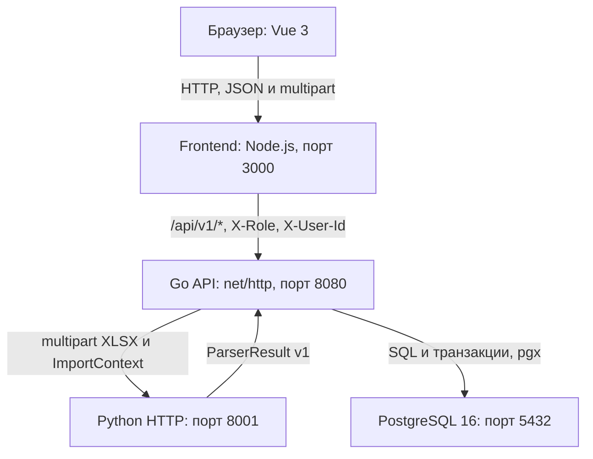

# Архитектура прототипа Re:Hub

Схема сверена с `docker-compose.yml`, `frontend/src/server.mjs`, `frontend/src/composables/live-api.js`, `backend/cmd/api/main.go` и обработчиками `backend/internal/api`. Состояние исходного кода: main `ca2ac88`; последующие изменения этой проверки затрагивают контракт, документацию и регрессионный тест.

## Компоненты и границы

| Компонент | Что делает | Чего не делает |
|---|---|---|
| Vue в браузере | Фильтры, карточки, импорт, подтверждение, CSV ошибок и роль для демонстрации | Не пишет напрямую в БД |
| Node frontend | Раздаёт статические файлы, проксирует `/api/v1/*` в Go | Не применяет доменные правила и не подтверждает личность пользователя |
| Go API | Права действий, отбор, валидация срезов, preview, транзакционная запись, история и назначения | Не разбирает ячейки XLSX самостоятельно |
| Python | Проверяет загрузку и ZIP, разбирает XLSX, сохраняет координаты и выдаёт ParserResult | Не обращается к PostgreSQL и не наследует значения из истории |
| PostgreSQL | Хранит клиентов, периоды, срезы, назначения, события и ошибки импорта | Не получает запросы от браузера напрямую |

Локальный Compose публикует только frontend на `127.0.0.1:3000`. Go, Python и БД доступны внутри сети Compose. БД хранится в томе `rehub_pgdata`. Backend применяет миграции при старте; health checks задают порядок запуска зависимостей. Промышленная конфигурация описана отдельно в [deploy](../../deploy/README.md).

## Путь импорта и ошибки

1. Администратор отправляет настоящий файл в `/api/v1/clients/import?preview=true` или `/api/v1/slices?preview=true`. Frontend передаёт запрос в Go.
2. Go ограничивает размер, сохраняет временный XLSX и отправляет его в Python `/parse` с ImportContext. Python проверяет файл, разбирает строки и валидирует ответ по JSON Schema.
3. Go отклоняет нарушения контракта, затем проверяет справочник, период, дубли и числа. Пропущенное total может наследоваться только из предыдущего среза того же клиента и периода.
4. Preview возвращает корректные строки и ошибки без записи. Для сохранения браузер повторно отправляет файл. При ошибках требуется `accept_partial=true`; Go повторяет валидацию в транзакции и записывает допустимые строки.
5. UI формирует CSV из массива ошибок ответа. Отдельного маршрута `/slices/{id}/errors` нет. Сбой Python возвращается как технический отказ, а не как успешный импорт пустого файла.

Контракт и ответы: [OpenAPI](../../backend/contracts/openapi.yaml), [ImportContext](../../contracts/import-context.schema.json), [ParserResult](../../contracts/parser-result.schema.json).

## Роли и сохранение

Администратор готовит пул. Операторы берут свободного клиента, забирают назначенного себе, передают своего коллеге или освобождают вручную. Проверки находятся в Go и SQL; UI не является единственной границей доступа. События звонков, назначения и реквизиты официальных писем сохраняются в БД. Передача не считается звонком и скрыта в пользовательской истории общения. [Правила ролей](../scenarios/roles-and-statuses.md).

`X-Role` и `X-User-Id` задаются браузером. Это демонстрационная идентификация, позволяющая проверить сценарии ролей, но не защита от подмены пользователя. JWT, `/auth/login` и управление сотрудниками не реализованы. Нельзя считать прототип готовым к открытому использованию с рабочими данными заказчика.

## Отдельный стенд замеров

`/study` и `/pilot` работают с синтетическими наборами в браузере. `/study` измеряет подготовку списка и сохраняет протокол в localStorage с экспортом JSON/CSV. Он не проверяет импорт через Go/Python/БД. Результаты пользовательских попыток и технической интеграции [хранятся отдельно](../../reports/H-00-status.md).

В основном интерфейсе режим в памяти включается только явной настройкой `REHUB_MODE=demo`. При сбое Go синтетические клиенты автоматически не подставляются.

## Почему такой контур

- `net/http` оставлен после сравнения маршрутизаторов: текущим обработчикам не нужен дополнительный фреймворк.
- Парсер выделен из Go из-за библиотек работы с XLSX. Его ответ ограничен JSON-контрактом, а запись остаётся в одном владельце транзакции.
- Предпросмотр отделён от подтверждения, чтобы пользователь мог увидеть ошибки и явно разрешить частичный импорт. Повторная серверная проверка не доверяет данным предпросмотра.
- Для прототипа используются Compose и одна БД. Очередь задач, отдельные сервисы авторизации и дополнительные базы не добавлены.

[Журнал решений](../decisions/change-log.md), [результат проверки готовности](../../reports/prototype-readiness.md).
